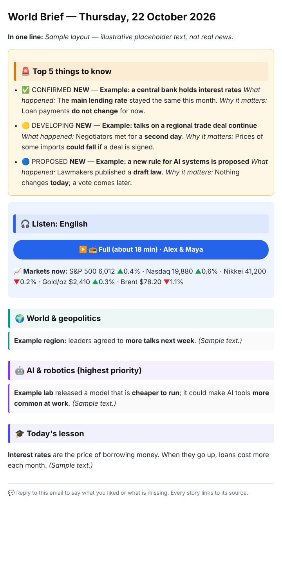

# 🌏 World Brief

**Your own free daily world-news email, with a podcast inside. Fully automatic. Set up once, about 10 minutes.**

Every morning you get **one complete email**:
- the **5 things to know**
- **what actually matters today** (what happened, why, who is affected, what happens next)
- the **whole world**, region by region
- AI & tech, money & markets, science, climate, disasters
- a **truth check**, a **2-minute lesson**, and every other headline at the end

It is written in simple English and every fact links to its source. A **two-host podcast** (15–30 min) is right inside the email.

Optional extras:
- the same news as **one Telegram message**
- a **Sunday weekly deep-dive**
- **breaking-news emails**, only for very big news
- **extra focus** on your own country and city

<p align="center"></p>

| | |
|---|---|
| 💸 **Free** | Free AI tier (Google Gemini, with free backups), Gmail, GitHub. No credit card anywhere. |
| 🌍 **Whole world by default** | No country is targeted unless you ask. Add countries or cities in one line of `config.yaml`. |
| 🔒 **Yours** | Runs in *your* GitHub account or on *your* computer. No sign-up, no tracking, nothing sent to us. |
| 🛟 **Never misses** | Retries, backup AI, a hard time limit on every AI answer, a missing-email alarm, news sources that clean themselves up. |
| 🧾 **Honest** | Only facts from ~200 news feeds, each with a link. Unverified claims are labelled ⚠️. |

---

## Choose how to run it

| | **A) GitHub (recommended)** | **B) Docker** |
|---|---|---|
| You need | a GitHub account | a computer/server that stays on (home server, Raspberry Pi, VPS) |
| Install | nothing | Docker |
| Cost | free | free |
| Podcast | web player + podcast-app feed (GitHub Pages) | attached to the email (and Telegram) |

### A) GitHub — 5 steps, no install

1. **Copy the project.** Click **Use this template → Create a new repository**. Make it **Public**: GitHub Actions minutes are unlimited for public repos. Your keys stay secret either way.
2. **Get two free keys:**
   - **Gemini API key:** https://aistudio.google.com/apikey → *Create API key*.
   - **Gmail app password:** turn on 2-Step Verification, then https://myaccount.google.com/apppasswords → create one called "World Brief" and copy the 16 letters.
3. **Answer a few questions.** In your new repo click **Code → Codespaces → Create codespace** (free), then type:
   ```bash
   python setup.py
   ```
   It asks your time zone, send time, optional countries or cities, podcast hosts and voice accent. Then it saves `config.yaml` and lists the secrets to add. Commit `config.yaml`. In a Codespace: `git add config.yaml && git commit -m "my settings" && git push`.
4. **Add your secrets:** repo **Settings → Secrets and variables → Actions → New repository secret**:
   - `GEMINI_API_KEY`
   - `GMAIL_USER`
   - `GMAIL_APP_PASSWORD`
   - `TO_EMAIL`
   - optional: `EXTRA_EMAILS` (others who should get it, comma-separated)
5. **Test.** **Actions** → enable workflows if asked → **World Brief → Run workflow → `keycheck`**. You get a ✅/❌ email for every key. Then **Run workflow → `morning`** sends today's brief right away.

From now on it arrives every morning by itself.

**Podcast player (optional, 1 minute):** after the first podcast, open **Settings → Pages → Branch: `podcast` / root → Save**. Your email then shows a ▶️ button that plays in any browser, and you get a private feed for podcast apps. Without Pages, the MP3 is attached to the email instead.

**On-time tip:** GitHub sometimes starts scheduled runs late. The workflow checks every 30 minutes, so a missed slot is caught by the next one. If you want it exactly on time, add a free [cron-job.org](https://cron-job.org) job that calls the `workflow_dispatch` API with `{"ref":"main","inputs":{"command":"due"}}`.

### B) Docker — your own machine

```bash
mkdir world-brief && cd world-brief
curl -fsSLO https://raw.githubusercontent.com/dheerajd9/world-brief/MASTER/docker-compose.yml
docker compose run --rm world-brief setup        # the same wizard; saves ./data/config.yaml + ./data/.env
docker compose run --rm world-brief check keys   # ✅/❌ email for every key
docker compose up -d                             # runs forever, sends every morning
```
- **Send one now:** `docker compose run --rm world-brief run morning`
- **Logs:** `docker compose logs -f`
- **Where things are:** everything (settings, keys, memory, archive) lives in `./data` on your machine.

The image works on Intel/AMD and ARM (Raspberry Pi, Apple Silicon).

---

## Settings (`config.yaml`)

```yaml
you:      {timezone: Europe/London}
email:    {send_time: "07:00", weekly: true, from_name: World Brief}
focus:    {countries: [gb], cities: [London]}   # optional; empty = whole world only
podcast:  {enabled: true, hosts: [Alex, Maya], accent: en-GB, languages: []}
telegram: {enabled: false}
alerts:   {breaking: false}
feeds_extra: []                                  # add any RSS feed
```

**Settings:**
- Every option is explained in [`config.example.yaml`](config.example.yaml).
- Ready-made profiles are in [`examples/`](examples/): world-only, India-USA, UK, Canada and Australia.

**Countries:**
- Any 2-letter code works.
- Ready-made news packs: `in` India, `us` USA, `gb` UK, `ca` Canada, `au` Australia.
- Each country you add gets its own section, extra sources and its stock index.

**Podcast:**
- English first, two hosts.
- Accents: `en-US`, `en-GB`, `en-IN`, `en-AU`, `en-CA`.
- Optional extra languages: `te` Telugu and `hi` Hindi. More can be added; open an issue.

**Telegram:**
- One message per edition: the podcast + headlines + 📖 Full news button.
- Create a bot with @BotFather, add it as an admin of your channel, set `TELEGRAM_BOT_TOKEN`, then run `telegram-setup` from Actions, or `python -m app telegram setup`.

## Commands

| GitHub (Actions → Run workflow) | Docker / your computer | What it does |
|---|---|---|
| `due` | `python -m app run due` | sends whatever is due and not sent yet (the schedule uses this) |
| `morning` / `weekly` | `python -m app run morning` | builds and sends an edition now |
| `podcast` | `python -m app podcast morning` | remakes today's podcast from the sent email |
| `keycheck` | `python -m app check keys` | tests every key and emails you the result |
| `feedcheck` | `python -m app check feeds` | tests every news feed; report goes to `logs/feedcheck.txt` |
| `watchdog` | `python -m app watchdog` | the "was it sent today?" check |
| `telegram-setup` | `python -m app telegram setup` | finds your Telegram channel |

Add `--dry-run` to build everything without sending anything.

## How it works

1. **Read the news:** about 200 RSS feeds covering every region, world economy, AI and tech, science, fact-checkers and official sources, plus your country packs and cities.
2. **Merge duplicates:** the same story from different outlets becomes one item, and the number of outlets carrying it is counted. Any story carried by 3 or more outlets always reaches the AI.
3. **Write the brief:** the free AI (Gemini, then Mistral and OpenRouter as backups) writes it using **only** those facts, with a source ID on every line. A second pass removes anything the sources don't support.
4. **Make the podcast:** the brief becomes a two-host conversation with chapters, voiced by Gemini voices, with free Microsoft and Google voices as backups.
5. **Send:** **one email**, then the optional Telegram message. The archive and story memory are saved, so tomorrow's brief says "Previously…" instead of repeating itself.

Safety nets:
- every AI answer has a hard time limit
- the email waits for the podcast for up to 2 hours, then goes without it
- you get an alarm if nothing was sent by 7 hours after your send time
- feeds that stay dead for two Sundays are switched off automatically
- an automatic end-to-end test runs on every change, including your `config.yaml`

**Docs:** [PRD](docs/PRD.md) · [Architecture](docs/ARCHITECTURE.md) · [Flows](docs/UX_FLOWS.md) · [Config & commands](docs/API.md) · [Data](docs/DATABASE.md) · [Security](docs/SECURITY.md) · [Errors](docs/ERROR_HANDLING.md) · [Deployment](docs/DEPLOYMENT.md) · [Testing](docs/TESTING.md) · [Roadmap](docs/ROADMAP.md) · [Changelog](docs/CHANGELOG.md)

## FAQ

**Is it really free?** Yes. These are all free tiers:
- Google Gemini (no card needed)
- Gmail SMTP
- GitHub Actions (unlimited on public repos)
- GitHub Pages
- the edge-tts and gTTS voices

**Is my repo public a problem?** Your keys are GitHub *Secrets*, never visible. What is public is your `config.yaml` (time zone, countries) and the news archive. If you prefer private, a private repo also works, using part of the free 2,000 Actions minutes a month: one edition is about 15–30 minutes.

**Something went wrong?**
- If a run fails, you get an email (and a Telegram message if `TELEGRAM_CHAT_ID` is set).
- Open the run under **Actions**: the log shows the minute of every step, like `[12m] written by …`.

## License

MIT. Use it, change it, share it. News content belongs to its publishers. World Brief links to the original articles and only writes short summaries.
